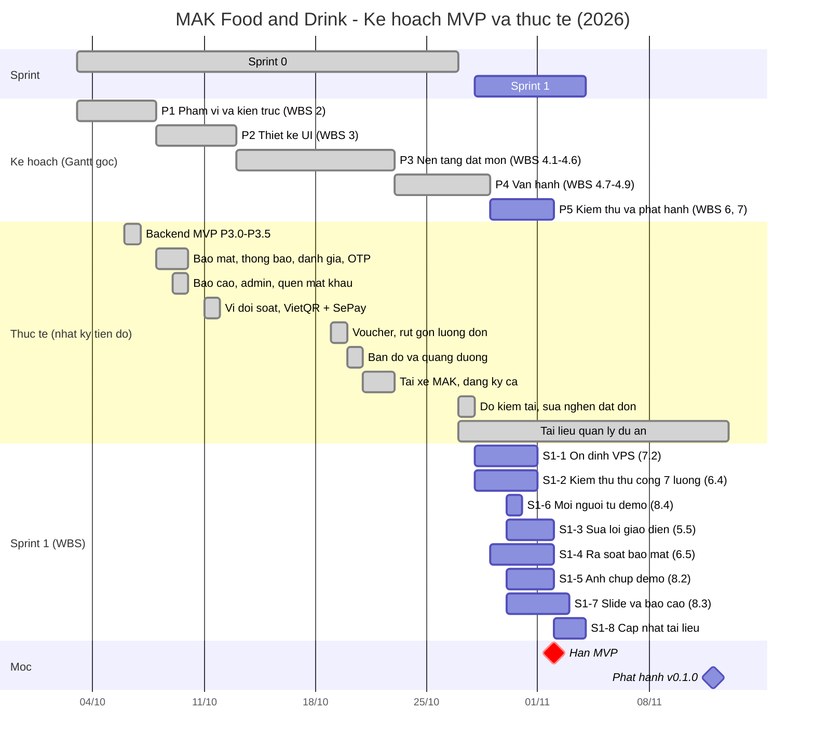

# Gantt — Tiến độ đồ án — MAK Food and Drink

> Nhóm 5, CSE3045. Cập nhật: 20/11/2026. Người lập: Lương Minh Khánh.
> Tài liệu liên quan: [WBS.md](WBS.md) (mã gói công việc) · [project.md](project.md) mục 8 (lộ trình), mục 11 (nhật ký tiến độ) · [SPRINT0-REPORT.md](SPRINT0-REPORT.md) mục 5 (Sprint 1)

Bản Gantt kế hoạch gốc là `HW3/Gantt_MVP_he_thong_dat_mon.xlsx` (03/10 → 02/11/2026). File này không nằm trong Git vì `HW3/` bị `.gitignore` chặn, nên được dựng lại dưới đây bằng Mermaid, xem được trực tiếp trên GitHub. Ngày tháng lấy từ [project.md](project.md) và [SPRINT0-REPORT.md](SPRINT0-REPORT.md).

## 1. Kế hoạch MVP và tiến độ thực tế

Thanh màu xám (`done`) là việc đã xong; thanh đỏ (`crit`) là mốc hạn chót.

Tên việc trong biểu đồ viết không dấu cho gọn. Bảng dưới là bản đầy đủ.

## 2. Bảng tiến độ

| WBS | Công việc | Kế hoạch | Thực tế / hạn | Người phụ trách (R) | |
|---|---|---|---|---|---|
| 2 | P1 — Phạm vi và kiến trúc | 03/10 – 08/10 | Xong; câu hỏi mục 10 còn mở | An Đức Mạnh, Lương Minh Khánh | 🟡 |
| 3 | P2 — Thiết kế UI | 08/10 – 13/10 | UI khách xong; wireframe chủ quán chưa có | Trương An | 🟡 |
| 4.1–4.6 | P3 — Nền tảng đặt món | 13/10 – 23/10 | **Xong sớm 06/10** | An Đức Mạnh | ✅ |
| 4.7–4.9 | P4 — Vận hành | 23/10 – 29/10 | Báo cáo 09/10, đánh giá 08/10; COD `paymentStatus` chưa làm | An Đức Mạnh | 🟡 |
| 4.10 | Mở rộng ngoài kế hoạch (voucher, ví, VietQR, bản đồ, tài xế, ca) | Không có trong Gantt gốc | 11/10 – 22/10 | An Đức Mạnh | ✅ |
| 6, 7 | P5 — Kiểm thử và phát hành | 29/10 – 02/11 | Đo tải 27/10; triển khai `sv22`; tag `v0.1.0` 12/11 | Cả nhóm | 🟡 |
| 7.2 | S1-1 Ổn định VPS | 28/10 – 31/10 | Hạn 31/10 | An Đức Mạnh | 🟡 |
| 6.4 | S1-2 Kiểm thử thủ công 7 luồng | 28/10 – 31/10 | Hạn 31/10 | Lương Minh Khánh | 🟡 |
| 5.5 | S1-3 Sửa lỗi giao diện | 30/10 – 01/11 | Hạn 01/11 | Trương An | 🟡 |
| 6.5 | S1-4 Rà soát bảo mật | 29/10 – 01/11 | Hạn 01/11 | An Đức Mạnh | 🟡 |
| 8.2 | S1-5 Ảnh chụp demo | 30/10 – 01/11 | Hạn 01/11, chưa có `docs/images/` | Lương Minh Khánh | ⬜ |
| 8.4 | S1-6 Mỗi người tự demo | 30/10 | Họp 30/10 | Cả nhóm | 🟡 |
| 8.3 | S1-7 Slide và báo cáo | 30/10 – 02/11 | Hạn 02/11 | Lương Minh Khánh | 🟡 |
| — | S1-8 Cập nhật tài liệu sau phát hành | 02/11 – 03/11 | Tài liệu cập nhật tới 12/11 | An Đức Mạnh | ✅ |

## 3. Nhận xét tiến độ

- **Backend đi trước kế hoạch:** P3 dự kiến 13/10 – 23/10 nhưng xong ngày 06/10 ([project.md](project.md) mục 8).
- **Phình phạm vi:** khoảng 11/10 – 22/10 nhóm làm thêm nhiều tính năng không có trong Gantt gốc (WBS 4.10), trong khi wireframe chủ quán (WBS 3.3) và ảnh demo (WBS 8.2) vẫn chưa xong ([RISKS.md](RISKS.md) R8, Retro Sprint 0).
- **Phát hành trễ hơn hạn MVP:** hạn MVP là 02/11, tag `v0.1.0` được gắn ngày 12/11.
- Từ Sprint 2, mỗi Sprint Planning cập nhật lại bảng mục 2 và thêm section mới vào biểu đồ. Ngày bắt đầu Sprint 2, 3 chưa được chốt trong [TEAM.md](TEAM.md) mục 3 ("Sau Sprint 1").
