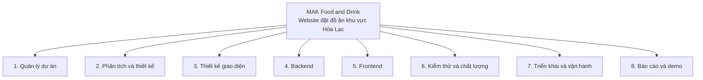

# WBS — Cấu trúc phân rã công việc — MAK Food and Drink

> Nhóm 5, CSE3045. Cập nhật: 20/11/2026. Người lập: Lương Minh Khánh (PO, phụ trách WBS/Gantt — [scrum.md](scrum.md) mục 2).
> Tài liệu liên quan: [GANTT.md](GANTT.md) (tiến độ theo thời gian) · [CHARTER.md](CHARTER.md) · [project.md](project.md) mục 5, 8 · [TEAM.md](TEAM.md) (RACI)

WBS chia đồ án thành **8 gói công việc cấp 1**, mỗi gói chia tiếp thành các gói nhỏ có **đầu ra kiểm chứng được**. Bản này chuyển WBS cũ (ảnh `HW3/WBS food ordering.png`, không nằm trong Git vì `HW3/` bị `.gitignore` chặn) thành Markdown để xem được ngay trên GitHub, và cập nhật theo tiến độ thực tế trong [project.md](project.md) mục 11.

Ký hiệu trạng thái giống [project.md](project.md): ✅ đã xong · 🟡 đang làm / làm một phần · ⬜ chưa làm. Cột **R** là người trực tiếp làm, theo bảng RACI trong [TEAM.md](TEAM.md).

## 1. Sơ đồ cấp 1

## 2. Bảng phân rã chi tiết

### 1. Quản lý dự án

| Mã | Gói công việc | Đầu ra | R | |
|---|---|---|---|---|
| 1.1 | Project Charter, chốt đề tài | [CHARTER.md](CHARTER.md), README | Lương Minh Khánh | ✅ |
| 1.2 | WBS và Gantt | [WBS.md](WBS.md), [GANTT.md](GANTT.md) | Lương Minh Khánh | ✅ |
| 1.3 | Quy trình Scrum, Product Backlog, Sprint Backlog | [scrum.md](scrum.md), [SPRINT0-REPORT.md](SPRINT0-REPORT.md) | Lương Minh Khánh | ✅ |
| 1.4 | Phân vai, RACI, quy ước giao tiếp | [TEAM.md](TEAM.md) | An Đức Mạnh | ✅ |
| 1.5 | Quản lý rủi ro | [RISKS.md](RISKS.md) | Lương Minh Khánh | ✅ (xem lại mỗi Sprint) |
| 1.6 | Đăng ký các bên liên quan | [STAKEHOLDERS.md](STAKEHOLDERS.md) | Lương Minh Khánh | ✅ |
| 1.7 | Quản lý cấu hình, quy ước Git | [CONFIG.md](CONFIG.md), [GIT.md](GIT.md) | An Đức Mạnh | ✅ |

### 2. Phân tích và thiết kế (P1)

| Mã | Gói công việc | Đầu ra | R | |
|---|---|---|---|---|
| 2.1 | Nghiệp vụ, state machine đơn hàng | [project.md](project.md) mục 6 (BR-35) | An Đức Mạnh | ✅ |
| 2.2 | Phạm vi MVP, 3 vai người dùng, luồng nghiệm thu | [project.md](project.md) mục 1, 4, 5, 9 | Lương Minh Khánh | ✅ |
| 2.3 | Thiết kế cơ sở dữ liệu | [database.md](database.md) | An Đức Mạnh | ✅ |
| 2.4 | Đặc tả API, mã lỗi, sự kiện realtime | [API.md](API.md) | An Đức Mạnh | ✅ |
| 2.5 | Chốt các câu hỏi nghiệp vụ còn mở | [project.md](project.md) mục 10 | Lương Minh Khánh | 🟡 (còn 4 câu chưa ghi quyết định) |

### 3. Thiết kế giao diện (P2)

| Mã | Gói công việc | Đầu ra | R | |
|---|---|---|---|---|
| 3.1 | Phác thảo giao diện khách (HTML đầu tiên) | `HW1/`, [PR #5](https://github.com/DucManh300905/cse3045-nhom-5/pull/5) | Trương An | ✅ |
| 3.2 | UI khách: trang quán, chọn size/topping, giỏ, thanh toán | [project.md](project.md) P2.1 | Trương An | ✅ |
| 3.3 | UI chủ quán: hồ sơ, giờ mở cửa, giấy tờ, thực đơn, nhận đơn | Wireframe `/owner/*` ([project.md](project.md) P2.2) | Trương An | ⬜ (đã làm thẳng bằng React, chưa có wireframe) |
| 3.4 | UI theo dõi đơn, đánh giá, admin duyệt quán | [project.md](project.md) P2.3 | Trương An | 🟡 |

### 4. Backend (P3, P4)

| Mã | Gói công việc | Đầu ra | R | |
|---|---|---|---|---|
| 4.1 | Hạ tầng chung: xử lý lỗi, validate, test, CI | P3.0 | An Đức Mạnh | ✅ |
| 4.2 | Tài khoản, hồ sơ, địa chỉ, đổi mật khẩu, OTP email | P3.1 | An Đức Mạnh | ✅ |
| 4.3 | Quán: hồ sơ, duyệt, giờ mở cửa, giấy tờ, audit log | P3.2 | An Đức Mạnh | ✅ |
| 4.4 | Thực đơn: danh mục, món, biến thể, topping, tìm không dấu | P3.3 | An Đức Mạnh | ✅ |
| 4.5 | Đặt đơn: tính giá phía server, trừ suất nguyên tử, idempotency | P3.4 | An Đức Mạnh | ✅ |
| 4.6 | Xử lý đơn: state machine, Socket.IO, job timeout | P3.5 | An Đức Mạnh | ✅ |
| 4.7 | Thanh toán COD hoàn chỉnh (`paymentStatus`) | P4.1 | An Đức Mạnh | ⬜ (để lại Product Backlog) |
| 4.8 | Doanh thu, hoa hồng, dashboard | P4.2 | An Đức Mạnh | ✅ |
| 4.9 | Đánh giá, thông báo, admin khóa user | P4.3 | An Đức Mạnh | ✅ |
| 4.10 | Mở rộng: voucher, ví đối soát, VietQR + SePay, bản đồ Goong, tài xế MAK, ca tài xế | [project.md](project.md) mục 11, bước 15–21 | An Đức Mạnh | ✅ |
| 4.11 | Swagger `/api/docs` | API-10 | An Đức Mạnh | ⬜ |

### 5. Frontend

| Mã | Gói công việc | Đầu ra | R | |
|---|---|---|---|---|
| 5.1 | Kênh khách: danh sách quán, trang quán, giỏ, thanh toán, theo dõi đơn | `frontend/src/pages/` | Trương An | ✅ |
| 5.2 | Kênh chủ quán `/owner/*` | `frontend/src/pages/owner/` | Trương An | ✅ |
| 5.3 | Trang quản trị `/admin/*` | `frontend/src/pages/admin/` | Trương An | ✅ |
| 5.4 | App tài xế `/shipper` | `frontend/src/pages/shipper/` | Trương An | ✅ |
| 5.5 | Sửa lỗi giao diện, hiển thị trên điện thoại | Sprint 1, S1-3 | Trương An | 🟡 |

### 6. Kiểm thử và chất lượng

| Mã | Gói công việc | Đầu ra | R | |
|---|---|---|---|---|
| 6.1 | Test tự động backend (Jest + Supertest) | `backend/tests/` (330 test) | An Đức Mạnh | ✅ |
| 6.2 | Test đơn vị frontend (Vitest) | `frontend/src/**/*.test.ts` | Lương Minh Khánh | ✅ (HW3) |
| 6.3 | CI GitHub Actions: test tự chạy mỗi lần push / mở PR | `.github/workflows/ci.yml` | An Đức Mạnh | ✅ |
| 6.4 | Kiểm thử thủ công 7 luồng nghiệm thu trên VPS | Checklist ([project.md](project.md) mục 9), Sprint 1 S1-2 | Lương Minh Khánh | 🟡 |
| 6.5 | Rà soát bảo mật, phân quyền chéo giữa các quán | Sprint 1 S1-4 | An Đức Mạnh | 🟡 |
| 6.6 | Đo kiểm tải | [loadtest.md](loadtest.md) | An Đức Mạnh | ✅ (cần đo lại sau S1-1) |

### 7. Triển khai và vận hành

| Mã | Gói công việc | Đầu ra | R | |
|---|---|---|---|---|
| 7.1 | Triển khai lên VPS lab | `https://sv22.bcse-vju.com` | An Đức Mạnh | ✅ |
| 7.2 | Ổn định VPS (RAM / chuyển MongoDB sang Atlas) | Sprint 1 S1-1, [RISKS.md](RISKS.md) R1 | An Đức Mạnh | 🟡 |
| 7.3 | Sao lưu dữ liệu định kỳ | [CONFIG.md](CONFIG.md) mục 7 | An Đức Mạnh | ⬜ |
| 7.4 | Phát hành có tag | `v0.1.0` ([GIT.md](GIT.md) mục 5) | An Đức Mạnh | ✅ |

### 8. Báo cáo và demo

| Mã | Gói công việc | Đầu ra | R | |
|---|---|---|---|---|
| 8.1 | Kịch bản demo 3 phút, tài khoản demo | [scrum.md](scrum.md) mục 4 | Lương Minh Khánh | ✅ |
| 8.2 | Ảnh chụp màn hình cho demo | `docs/images/` (Sprint 1 S1-5) | Lương Minh Khánh | ⬜ |
| 8.3 | Slide và báo cáo cuối kỳ | Sprint 1 S1-7 | Lương Minh Khánh | 🟡 |
| 8.4 | Mỗi thành viên tự demo trọn luồng nghiệm thu | Sprint 1 S1-6 | Cả nhóm | 🟡 |

## 3. Quy tắc dùng WBS

- Mỗi gói công việc cấp cuối là **một issue** trên GitHub (hoặc một mục trong Sprint Backlog), ghi mã WBS trong tiêu đề, ví dụ `[WBS 6.4] Kiểm thử thủ công 7 luồng`.
- Gói nào đổi trạng thái thì cập nhật bảng này trong cùng PR với thay đổi đó ([scrum.md](scrum.md), Definition of Done mục 3).
- Thêm gói mới phải qua PO ở Sprint Planning ([SPRINT0-REPORT.md](SPRINT0-REPORT.md) mục 4, chống phình phạm vi — [RISKS.md](RISKS.md) R8).
